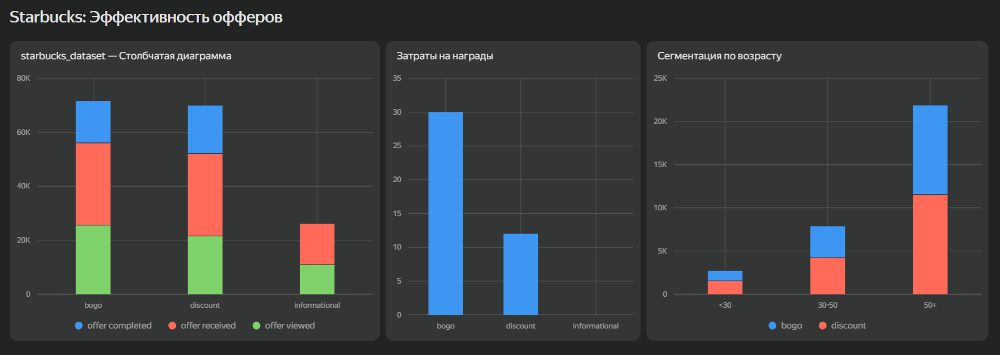
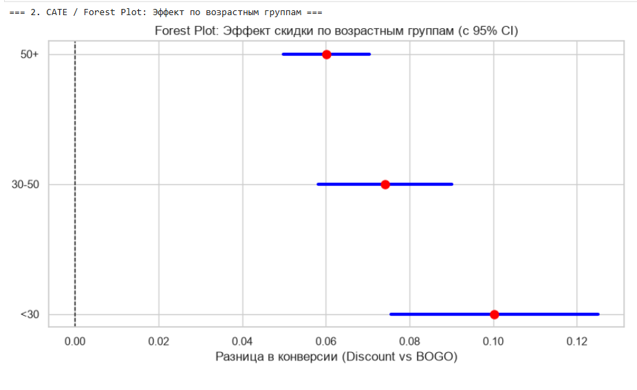

\# ☕ Starbucks Offer Uplift \& A/B Analysis

\## 📌 Бизнес-контекст

Starbucks отправляет клиентам в мобильное приложение три типа офферов: BOGO (Купи один — получи второй), Discount (Скидка) и Informational (Реклама). Компания несет большие затраты на награды, поэтому цель проекта — выяснить, какой тип оффера наиболее эффективен, и кому именно его стоит отправлять, чтобы максимизировать чистую прибыль.

\## 📊 Данные и инструменты

\* \*\*Данные:\*\* \[Starbucks Offers Advertisement Data (Kaggle)](https://www.kaggle.com/datasets/mexwell/starbucks-offers-advertisement-data) (170 тыс. пользователей, 300+ тыс. событий).

\* \*\*Стек:\*\* Python (Pandas, Seaborn, Matplotlib, Statsmodels).

\## 🛠 Этапы работы

1\. \*\*Data Audit:\*\* Очистка данных (удаление пользователей с аномальным возрастом 118 и отсутствующим доходом), распаковка JSON-словарей в колонке `value`.

2\. \*\*EDA \& Metrics:\*\* Построение воронки (Получен -> Просмотрен -> Выполнен) и расчет конверсии (CR).

3\. \*\*A/B Test:\*\* Z-test для пропорций (проверка статистической значимости).

4\. \*\*Экономика:\*\* Расчет Net Revenue (Выручка минус затраты на награды).

5\. \*\*Uplift \& Сегментация:\*\* Анализ эффективности офферов по возрастным группам.

\## 🔍 Ключевые инсайты

1\. \*\*Скидка конвертирует лучше:\*\* Несмотря на то, что BOGO открывают чаще (CR просмотра 83.4% против 70.2%), до покупки доходит больше людей со скидкой (CR выполнения 58.6% против 51.4%). Разница статистически значима (p-value < 0.001, Z-test).

2\. \*\*Скидка дешевле для бизнеса:\*\* На награды по BOGO компания потратила $113,440, а на скидки — всего $51,236. При практически равной выручке (около $1.58 млн), чистая прибыль от скидок выше.

3\. \*\*Целевая аудитория:\*\* Самая платежеспособная и активная группа — клиенты 50+. Они выполняют больше всего офферов, причем отдают явное предпочтение скидкам (Discount), а не BOGO.

### 🛡 Валидация эксперимента (SRM Check)
Перед анализом была проведена проверка Sample Ratio Mismatch (SRM). Распределение пользователей между группами BOGO и Discount было равномерным (Chi-square p-value = 0.86), что подтверждает корректность рандомизации и валидность результатов A/B-теста.

### 📊 Heterogeneous Treatment Effect (CATE)
Для оценки эффекта по сегментам был построен Forest Plot с 95% доверительными интервалами. Анализ показал, что **скидка (Discount) статистически значимо превосходит BOGO во всех возрастных группах**. При этом максимальный прирост конверсии от скидки наблюдается в группе до 30 лет.

\## 💡 Рекомендация для бизнеса

Не раскатывать BOGO на всю аудиторию, так как это экономически неэффективно. Сфокусироваться на отправке \*\*скидок (Discount)\*\* для возрастной группы \*\*50+\*\*. Это позволит снизить затраты на награды и увеличить Net Revenue.

## 📈 Интерактивный дашборд (Yandex DataLens)
Ознакомиться с результатами анализа можно в интерактивном дашборде: 
👉 [Посмотреть дашборд в DataLens](https://datalens.yandex/hpkx52wdb7d80?_share_link=public)

