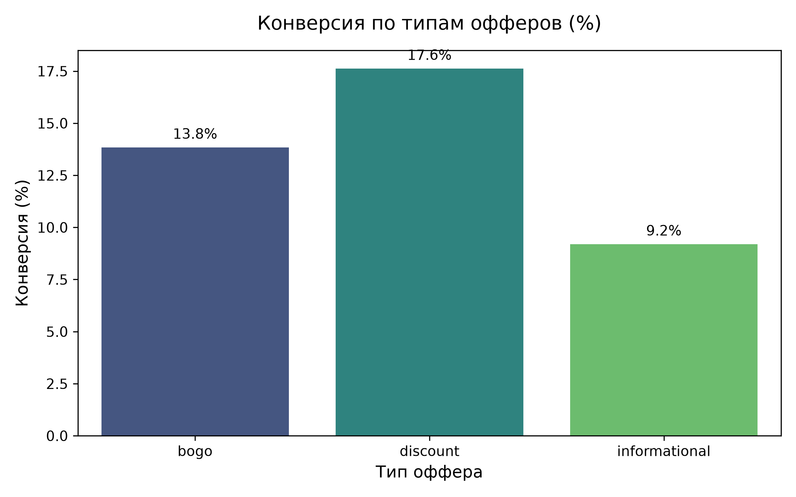
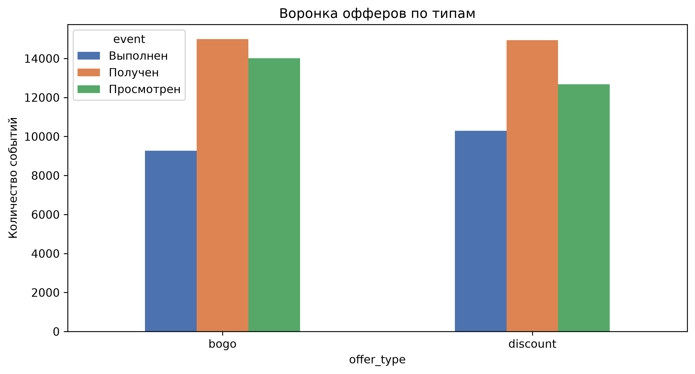
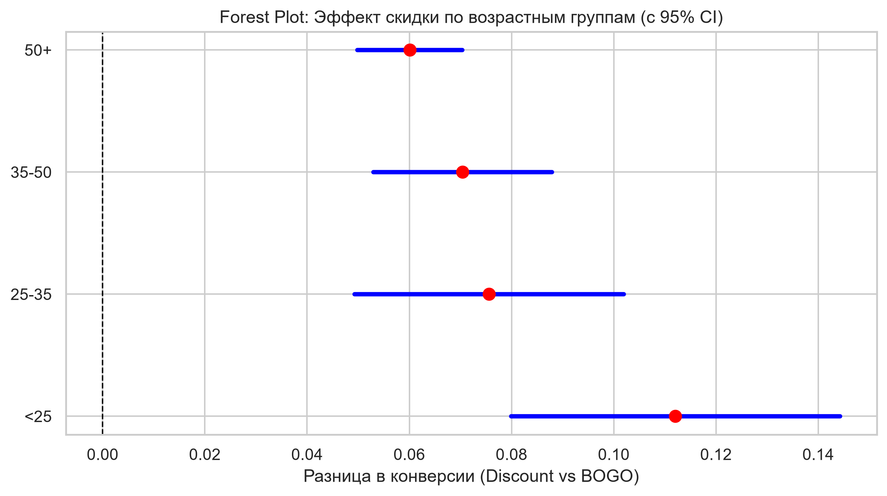
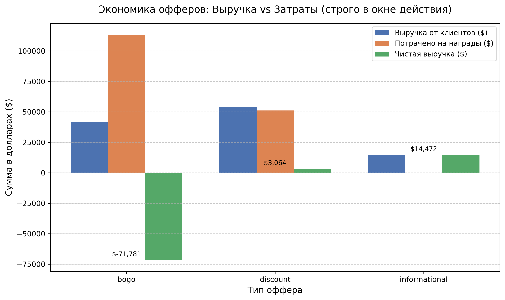
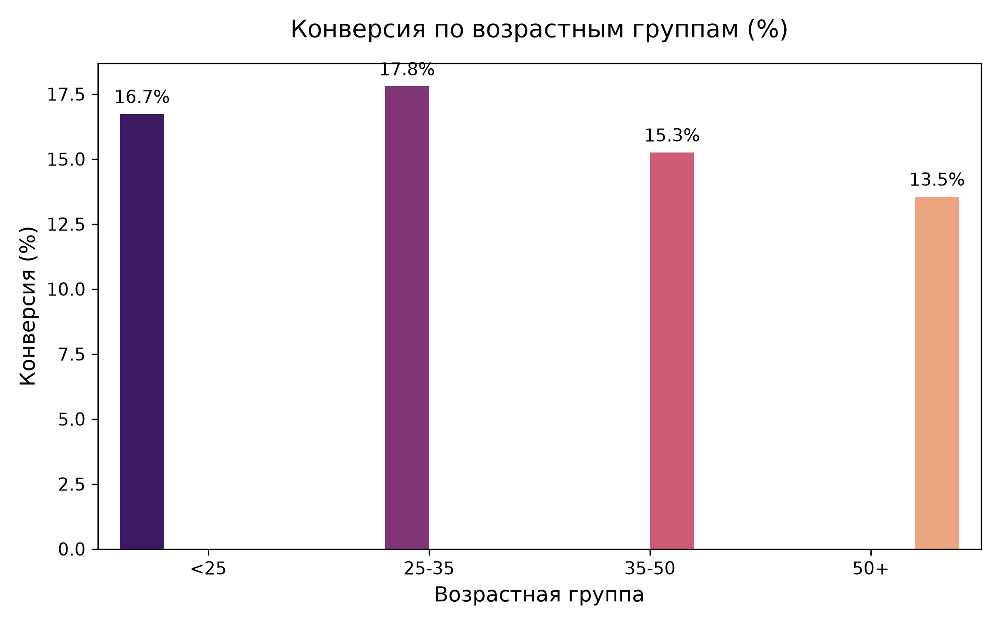
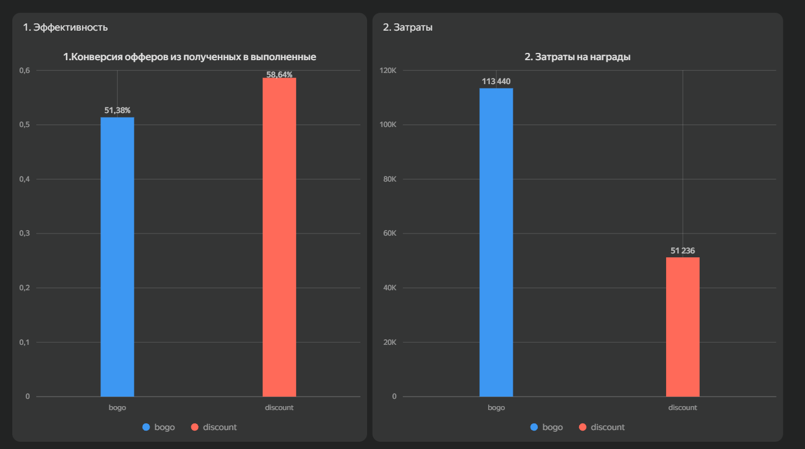

# Starbucks Offer Effectiveness Analysis

## Бизнес-задача
Компания Starbucks рассылает клиентам различные типы офферов (BOGO, скидки, информационные).
Задача — сравнить эффективность этих типов офферов с точки зрения конверсии в покупку и чистого дохода (Net Revenue), а также выявить, какие сегменты клиентов реагируют лучше.

## Данные
- **Источник:** симулированные данные Starbucks (портфолио-проект).
- **Объём:** ~17 000 пользователей, ~30 000 транзакций, 10 типов офферов.
- **Структура:**
  - `portfolio.json` — параметры офферов (reward, difficulty, duration, channels, offer_type);
  - `profile.json` — демография пользователей (пол, возраст, доход, дата регистрации);
  - `transcript.json` — события (получение оффера, просмотр, транзакция).

## Методология
1. **Очистка данных:** удаление выбросов по возрасту (118 лет — признак отсутствия данных), обработка пропусков, приведение типов.
2. **Определение конверсии:** транзакция пользователя в окне `[time_offer, time_offer + duration]`. Это ключевая целевая переменная — `is_converted`.
3. **Сравнительный анализ:** расчёт конверсии и Net Revenue по типам офферов, z-тест для пропорций.
4. **Сегментация:** анализ конверсии по возрастным группам и уровню дохода.
5. **Логистическая регрессия:** оценка влияния типа оффера и демографии на вероятность конверсии (с кластеризованными стандартными ошибками по пользователю).
6. Для проверки гипотез в сегментах (CATE по возрастным группам) применялась поправка Бонферрони на множественные сравнения. Поскольку анализировались 4 возрастные группы, скорректированный уровень значимости составил α = 0.05 / 4 = 0.0125. Все полученные эффекты прошли проверку на этом более строгом уровне значимости.

## Ключевые результаты

### Конверсия по типам офферов


*   **Discount (Скидки)** показали наивысшую конверсию — **17.6%**. 
*   **BOGO (1+1)** — **13.8%**.
*   **Informational** — **9.2%**. Ожидаемо низкий результат, так как оффер не содержит материального стимула.

### Воронка офферов по типам


### CATE: эффект скидки по возрастным группам


Эффект скидки положителен и статистически значим во всех возрастных группах. При этом разница эффекта между группами статистически незначима (interaction p = 0.583), что подтверждает универсальность скидки.

### Экономика офферов: выручка vs затраты


*Discount даёт более высокий Net Revenue ($1.53M), чем BOGO ($1.47M), несмотря на схожую выручку от клиентов.*

### Конверсия по возрастным группам


*   Наилучший отклик показывают клиенты **25–35 лет (17.8%)** и **до 25 лет (16.7%)**. 
*   С возрастом конверсия снижается: группа **50+** реагирует хуже всего **(13.5%)**.

### Результаты логистической регрессии (Cluster-Robust SE)
Была построена логистическая регрессия с кластеризованными стандартными ошибками по `person` (так как один пользователь мог получать несколько офферов).
*   **Скидки (Discount)** статистически значимо повышают шансы на покупку: **Odds Ratio = 1.53** (p-value < 0.001). То есть, шанс конверсии по скидке в 1.53 раза выше, чем по остальным офферам.
*   **Молодежь (25-35 лет)** также имеет более высокие шансы (Odds Ratio = 1.34, p-value < 0.001).
*   Однако *совместный* эффект (interaction) «молодежь + скидка» оказался статистически незначимым (p-value = 0.583). Это значит, что скидки работают одинаково хорошо и для молодых, и для старших.

## Интерактивный дашборд (DataLens)

Для визуализации результатов также собран интерактивный дашборд в Yandex DataLens. Он позволяет в реальном времени смотреть распределение событий, затрат и демографических сегментов.



## Бизнес-рекомендации

1. **Делать акцент на discount-офферах.** Они дают наивысшую конверсию (17.6% против 13.8% у BOGO) и лучший Net Revenue ($1.53M против $1.47M). При этом затраты на награды у discount в 2 раза ниже ($51K против $113K).

2. **Не сегментировать discount по возрасту.** Forest plot показывает, что эффект скидки не различается статистически значимо между возрастными группами (все CI пересекают ноль). Скидки работают универсально — это упрощает таргетинг и снижает стоимость персонализации.

3. **Информационные офферы требуют отдельной метрики.** Их конверсия низкая (9.2%), но они не содержат материального стимула. Возможно, их эффективность стоит измерять не через транзакции, а через вовлечённость (просмотры, время в приложении).

4. **Молодёжь 25–35 лет — приоритетный сегмент.** У них самая высокая конверсия (17.8%), что делает их привлекательной аудиторией для дальнейших экспериментов.

## Ограничения
- **Симулированные данные** → выводы не следует напрямую переносить на реальный бизнес.
- **Приблизительный Net Revenue** → расчёт основан на допущениях о среднем чеке и марже.
- **Отсутствие временных рядов** → нельзя оценить долгосрочный эффект (retention, LTV).
- **Возможный двойной учёт конверсий.** Если пользователь получил несколько офферов, и одна транзакция попала в окна действия нескольких офферов, она будет засчитана как конверсия для каждого из них. Это может незначительно завышать конверсию. В будущем стоит либо брать только первый оффер в цепочке, либо использовать модель с конкурирующими рисками.
- **Упрощённый расчёт Net Revenue.** Выручка считается как сумма всех транзакций пользователей, получивших оффер, без привязки к конкретному офферу. Это приближение, которое может завышать чистую прибыль.
- **Пропуски в данных о возрасте.** При очистке данных пользователи с аномальным возрастом (118 лет) были помечены как имеющие пропуски. Мы провели проверку на смещение (bias check) и выяснили, что пользователи с отсутствующим возрастом (которые также не имели данных о поле и доходе и были исключены из профиля) имеют схожий уровень конверсии — 13.6% против 14.5% у пользователей с известным возрастом. Поскольку разница составляет менее 1 п.п., мы считаем риск существенного смещения в сегментном анализе минимальным.

## Стек
- Python 3.14
- pandas, numpy — обработка данных
- statsmodels — статистические тесты и регрессия
- matplotlib, seaborn — визуализация
- pyarrow — работа с parquet

## Порядок запуска ноутбуков
1. `01_data_audit.ipynb` — загрузка, очистка, сохранение в parquet
2. `02_eda_and_metrics.ipynb` — EDA, воронка, z-тест, SRM
3. `03_offer_effectiveness_analysis.ipynb` — конверсия, регрессия, CATE

## Как воспроизвести
```bash
git clone https://github.com/Arkwark/starbucks-offer-effectiveness-analysis.git
cd starbucks-offer-effectiveness-analysis
pip install -r requirements.txt
jupyter notebook
```